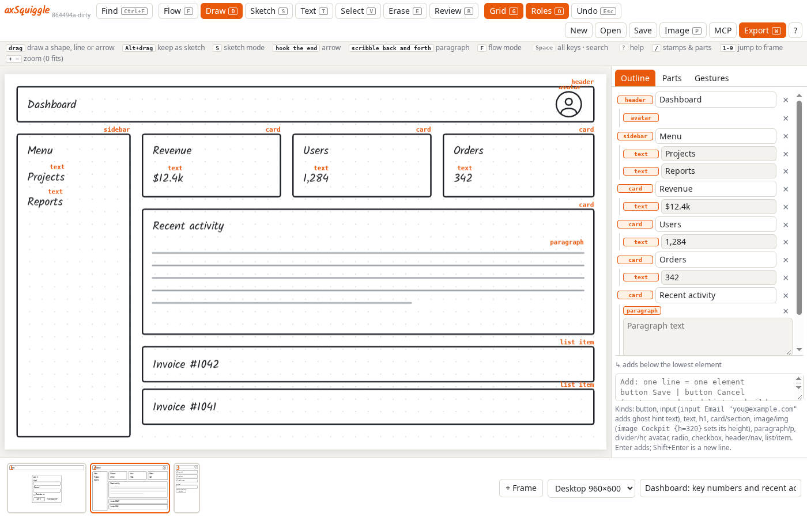
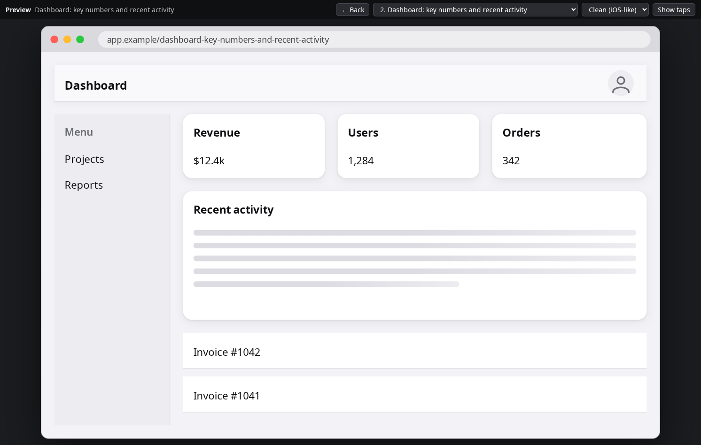
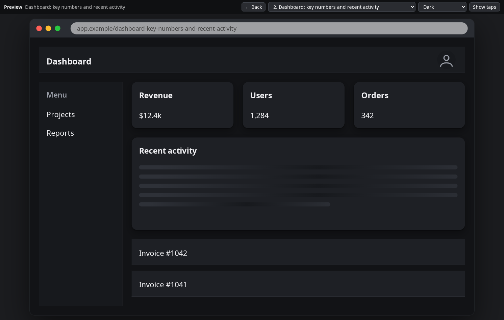
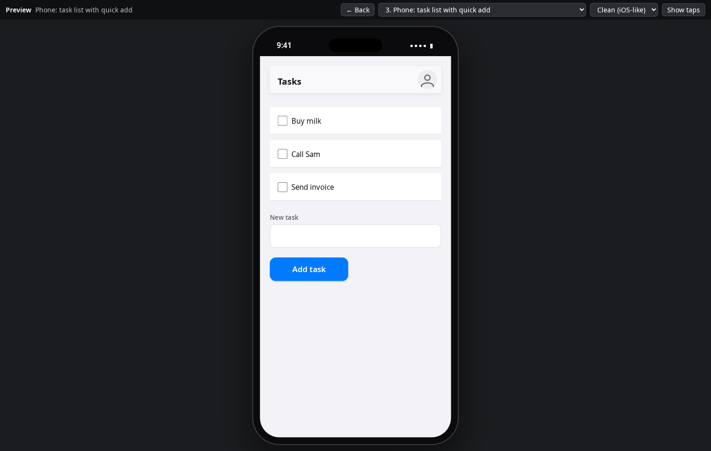

# axSquiggle

Fast wireframe and storyboard tool for writing specs. Sketch with mouse, touch or pen, or type an outline;
rough input becomes clean, labelled wireframe parts that size and align themselves.
Static, offline, no backend, no accounts.

**Sketch or type it.** Rough input becomes clean, labelled parts that size and align themselves. The outline on the right is the same drawing as text.



**Preview it for real.** Shift+V rebuilds every screen as working controls inside a browser or phone, with your links clickable.



**Pick a look.** Clean, Material, Dark, Bold brand or Minimal, on desktop or phone frames.

<p>
  
  
</p>

## Run it (pick one)

1. **Just the app.** Download `axsquiggle.html` and double-click it. One file, works offline, nothing to install. Also hostable anywhere as a
   static file (a hosted copy is published to GitHub Pages by `.github/workflows/pages.yml`).
2. **The app plus AI.** Download `axsquiggle.mjs` and run `node axsquiggle.mjs` (Node 18+, Windows, macOS or Linux, no `npm install`). It
   prints an address such as `http://127.0.0.1:4747/`: open it and the app is already connected. Add `--open` to open it for you.
3. **From source.** `npm install`, then `npm run dev` (app only), `npm start` (bridge + app), `npm test`, `npm run dist` (builds the two files in `dist/`).

New here? **`how-to.html`** is an animated guide (sketching, tap-and-type stamps, shortcut mode, parts, working with your AI); the app's **How to** button opens the same page, and it ships as its own file next to `axsquiggle.html`.

## Use it from an AI client (MCP)

The same `axsquiggle.mjs` is the MCP server: an AI client launches it and it speaks MCP on stdin/stdout by itself.

```json
{ "mcpServers": { "axsquiggle": { "command": "node", "args": ["C:/tools/axsquiggle.mjs"] } } }
```

Claude Code: `claude mcp add axsquiggle -- node /path/to/axsquiggle.mjs`. If a bridge is already running (step 2) the client joins it, so the
app you have open and the AI share one board. Clients that connect to a URL instead can use `http://127.0.0.1:4747/mcp` with
`Authorization: Bearer <token>` (the token is in `~/.axsquiggle/token`).

## Locked-down and corporate machines

Nothing here tries to defeat a security policy; it gives you the option that fits yours.

| What is blocked | What to do |
|---|---|
| Opening local `.html` files | Use the hosted copy (Pages or any internal static host): it is the same single file. |
| Downloading `.html` / `.mjs` (mail or web gateways) | Rename to `.txt` to move it, rename back to run. Both are plain text; there is no executable. |
| Installing Node (no admin rights) | Use the portable Node zip from nodejs.org (unzip anywhere, run `node.exe axsquiggle.mjs`), or run the bridge on a shared server (below). |
| `localhost` / `127.0.0.1` blocked or sent via the proxy | Add `localhost,127.0.0.1` to the proxy bypass list (`NO_PROXY`). The bridge serves the app itself, so the browser only ever talks to one same-origin address: no cross-origin or private-network checks apply. |
| A hosted copy of the app calling your local bridge | Chrome's "Private Network Access" prompt is answered by the bridge; allow your hosted origin with `AXSQ_ORIGINS=https://tools.example.com`. |
| Live updates broken by a proxy (server-sent events) | Automatic: the app falls back to polling every 3 seconds. |
| Nothing may run on laptops | Run one bridge on an internal server: `AXSQ_HOST=0.0.0.0 AXSQ_HOSTS=wire.corp.example AXSQ_PUBLIC_URL=https://wire.corp.example node axsquiggle.mjs bridge` behind your HTTPS reverse proxy. Everyone opens that address and types the token once; AI clients use `https://wire.corp.example/mcp` with a bearer token. In this mode the token is never written into the page. |
| The AI is a hosted agent that cannot see your machine | Same: point it at the server's `/mcp` URL. |

## Layout

- `src/core/` pure modules, no DOM: `recognize` (stroke recognition), `semantics` (roles + smart sizing),
  `layout` (outline builder and row edits), `exporters` (SVG, Figma SVG, Excalidraw, Markdown, HTML),
  `model` (validation, example board, raw JSON), `trace` (photo of a sketch to shapes).
  `agent` (read/edit/diff/review functions an outside AI uses), `connect` (arrow attach + routing), `links`, `parts`, `search`.
- `src/ui/` canvas, panels, dialogs. `server/` the AI bridge (HTTP + MCP). `tests/` Vitest suites.

## Saving and opening

The board autosaves in the browser. **New** starts an empty drawing (Undo brings the old one back). To keep it as a file (or move it, or version it in git), press **Ctrl/Cmd+S** or **Save**: one small JSON file, `{"axsquiggle":1,"frames":[...]}`. **Ctrl/Cmd+O**, **Open**, or dropping the file on the canvas brings it back (Undo reverts). In Chrome and Edge Save writes back to the same file; elsewhere it downloads. It is exactly what an AI gets from `get_board` (format `json`), and an AI can hand a whole board back with `load_board`.

## Keyboard

`Space` (or `Ctrl/Cmd+K`) lists every shortcut, `/` stamp and saved part in one compact panel: press a key and it runs, or press Tab or `/` to search (Enter runs the highlighted row). `F` Flow tool (draw, type, select and move with no tool switching),
`?` (the button at the end of the top row) opens the animated help, `Ctrl+F` search all frames, `/` the stamps and parts list, `Esc` undo (the first one after a drawn shape gives you the sketch back; with something selected it deselects first), `Shift+Esc` redo, `Ctrl+Z`/`Ctrl+Shift+Z` too, `Backspace`/`Del` delete, `Ctrl+A`/Shift+click/drag a box to multi-select, `B` save the selection as a reusable part
(stamp it with `/name` after tapping the canvas; name it `nav-bar: top navigation links` to add a one-line description), `L` link the selection to another frame, `I` click-through play mode.
Radios and checkboxes are typed in a run: tap the canvas, type `/radio`, then a label and Enter makes the next one below (empty Enter ends); in the
Outline, Enter on a radio/checkbox row does the same. Two or more form a group with a border (**Q** puts a border around any selection) that always
hugs its contents. A label can run to several lines (Shift+Enter); a later line that starts with spaces is a smaller, muted sub-label, and in the
outline text indented under a radio, checkbox or list item becomes its sub-label. Boxes grow to hold their text, rows re-align and borders re-fit on
their own: nothing needs resizing by hand.
An input takes ghost placeholder text: `input Email "you@example.com"` (or an indented line under it), and the Outline has a field for it.
An image or card takes a height: `image Cockpit view {h=320}` (default 160). An AI can also resize one later with `edit_element` `set_height`; whatever sits below it moves with its edge.
Basic controls: `/dropdown Country "Pick one"`, `/search`, `/tabs Day, Week, Month` (a button group), `/badge New`.

Tap the canvas and type `/radio Contact by: Email, SMS` (text before the colon titles the group, above its border), `/cb Remember me`, `/btn Save, Cancel`, `/field`, `/img`, `/card` to stamp elements.

## AI bridge (draft, review, action)

Let an outside AI draft the first screens, edit them yourself, leave review notes, and send it back to be actioned.

Start the bridge (see "Run it" above), add it to your AI client (see "Use it from an AI client"), and open the app through the bridge
address (or press **MCP** in the header and paste the URL and token). Then:

1. The AI calls `draft_board` with outline text (the same syntax as the Outline panel, `button Sign in -> 2` links frames).
2. You edit the draft in the app and write review notes (Review tool, loop the elements a note is about). Your edits sync to the bridge.
3. You tell the AI, in its own chat, that you have left notes. It calls `get_review` and gets the open notes (with the elements each
   points at), what you changed since its draft, and the board. Nothing is pushed to it: all AI works through MCP.
4. It acts with `edit_frame` / `edit_element`, then `resolve_notes` with a short reply per note. Its edits arrive in the app as one
   undoable change; resolved notes show struck through with its reply.

An **Image** element (a box with a cross) has a description, the words underneath it (select it and press Enter, or just type under it), which the AI reads. It can also show a real picture: select it and press **P**, or drop / paste an image onto it (scaled to 800px inside the board file); **Shift+P** takes it out again.

A photo of a hand sketch or a screenshot dropped onto a frame (the **Image** button, paste, or drag) comes back to the AI as an attached
image in `get_review` (or `get_board` with `include_images`), so it can look at it and build the wireframe itself. **K** traces the image
into shapes offline (no AI): boxes, circles, arrows and scribbled paragraphs are recognised, handwriting becomes "Label" placeholders.

Tools: `get_board`, `draft_board`, `edit_frame`, `edit_element`, `delete_frame`, `add_note`, `get_review`, `resolve_notes`,
`get_frame_svg`, plus board management: `list_boards`, `new_board`, `switch_board`, `rename_board`, `delete_board`.

**Several boards.** The bridge keeps named boards in `~/.axsquiggle/boards/<name>.json` (an earlier single `board.json` becomes `default`; deleted boards move to `.trash/`). One is open in the browser; every tool acts on it unless given `board_name`. An AI should `list_boards` first and `new_board` for unrelated work instead of adding to the open one. In the app, **Shift+B** (or the board name in the toolbar) switches or starts a board; opening a board starts with an empty Undo history. REST equivalents: `GET /api/boards`, `POST /api/tools/<name>`, `GET/PUT /api/board`, `GET /api/review`, `GET /api/events` (SSE).

Security: the bridge binds to 127.0.0.1, every request needs the token (`~/.axsquiggle/token`, or `AXSQ_TOKEN`), and browsers are limited to
localhost origins (add others with `AXSQ_ORIGINS`). Settings: `AXSQ_PORT`, `AXSQ_DIR`, `AXSQ_APP`. Writes carry a revision, so a stale
edit is refused instead of overwriting.

## Preview

Shift+V (or Export → Preview) opens a realistic preview of every screen: buttons, inputs, cards and lists rebuilt as real controls inside a phone or browser, with your links working. Pick the look with the style menu or press S to cycle (Clean, Material, Dark, Bold brand, Minimal). The same page is served by the bridge at `/api/export/preview?style=dark`, and Export → Preview saves it as one offline file.
